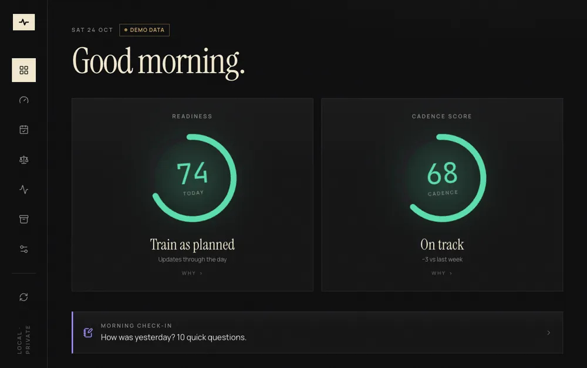
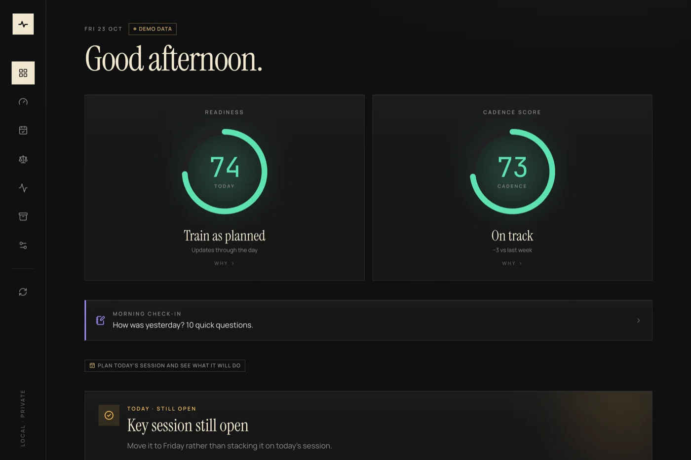
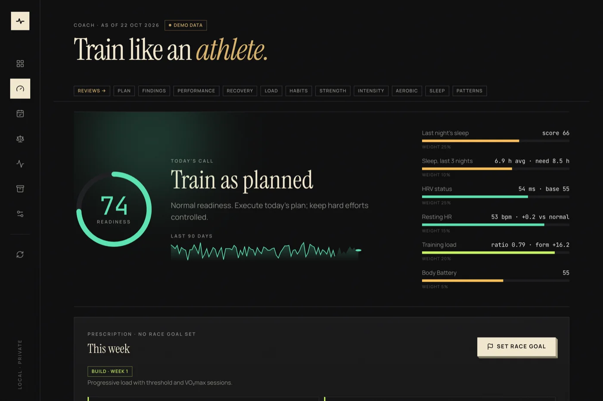
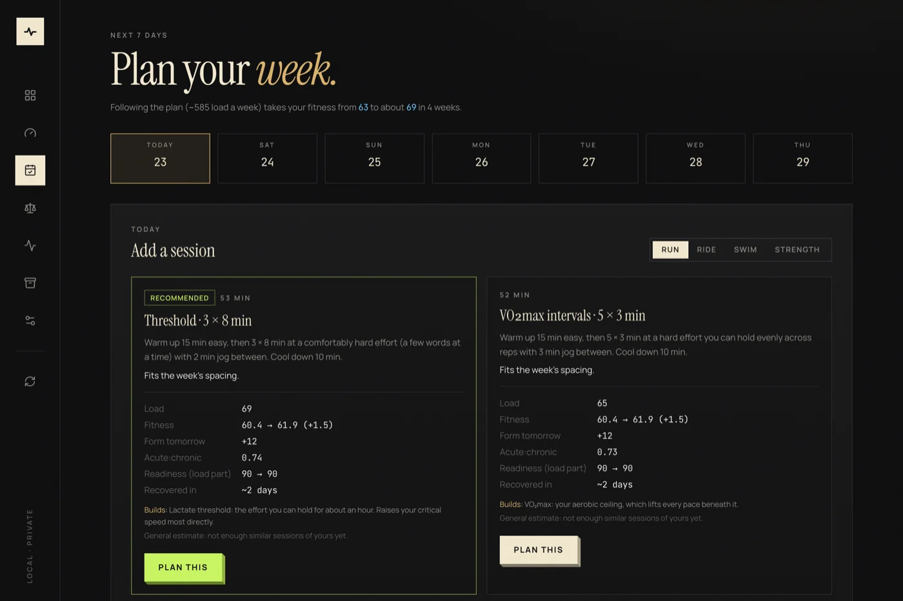
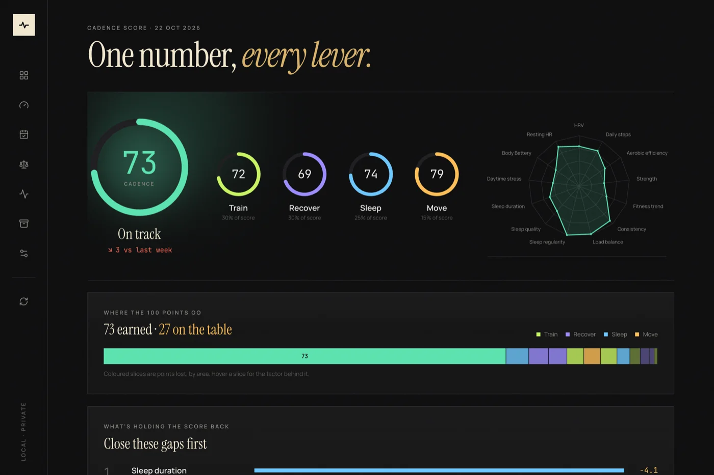
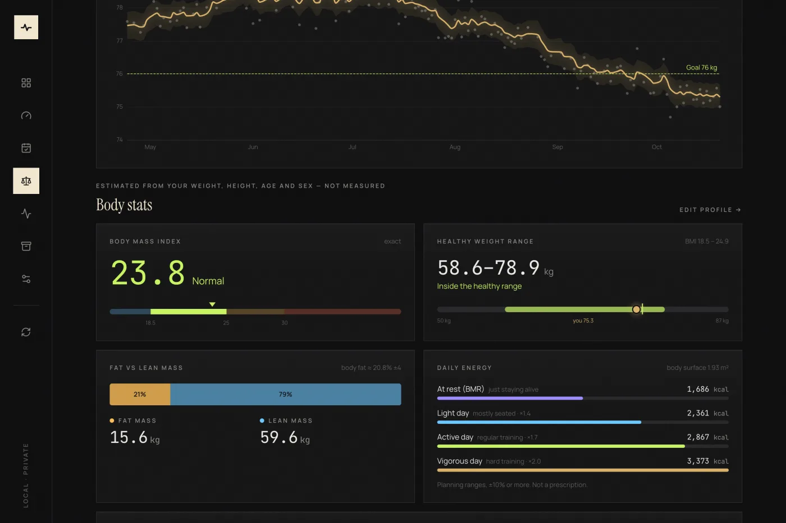
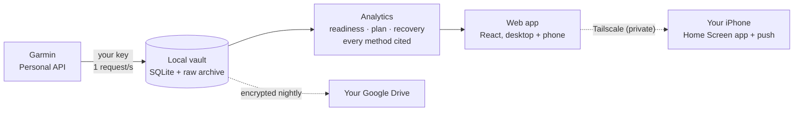
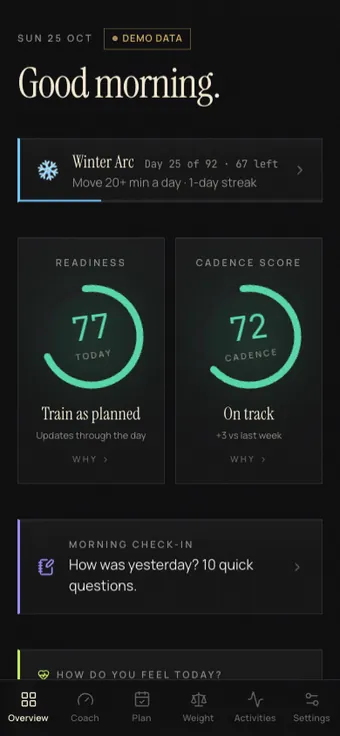

<h1 align="center">Cadence</h1>

<p align="center"><b>A private training coach for Garmin users. It shows its work, and your data never leaves your hands.</b></p>

<p align="center">
  <a href="https://github.com/RajatB15/cadence/actions/workflows/ci.yml"></a>
  <a href="LICENSE"></a>
  
  
  
  
</p>

<p align="center">
  
</p>

<p align="center"><sub>Everything above is the built-in demo data. No Garmin account needed to try it.</sub></p>

Garmin Connect shows you a readiness number. Cadence tells you **why it is that number**, builds a training plan that
bends around your race goal and your recovery, and runs on your own computer or a small server you control. Readiness,
a periodised plan, critical speed, habit insights, sleep targets and weekly reviews, from your own Garmin data, with
every method shown and nothing sent to a cloud service except the Garmin sync itself.

Cadence is not affiliated with Garmin. It reads your data through Garmin's official [Personal API](https://developer.garmin.com/gc-developer-program/personal/personal-api/).

**Jump to:** [Quick start](#quick-start-try-it-with-demo-data) · [Features](#features) · [How it works](#how-it-works) · [On your iPhone](#on-your-iphone) · [Run it always-on](#run-it-always-on) · [Privacy](#privacy)

## A look around

<p align="center">
  
  
</p>
<p align="center">
  
  
</p>
<p align="center">
  
</p>

## Why

Garmin Connect already shows trends and a readiness number. Cadence is for people who want to know *why* that
number is what it is, want a training plan that adapts to a race goal instead of a fixed template, and would
rather their health data stayed on their own machine.

- **Transparent, not a black box.** Every score's "How this works" cites its method — Banister fitness/fatigue,
  Theil–Sen trend fitting, Benjamini–Hochberg false-discovery control on "what moves your recovery" — and shows
  its sample size and confidence, not just a number.
- **A real training plan, not just a daily score.** Set a race goal and distance; Cadence builds base → build →
  race-specific → taper phases, ramps load with a cap, rotates threshold/VO₂max/race-pace sessions, and caps your
  long run at 10% growth (the rule a 2025 Garmin-runner injury study found safer than weekly load ratios).
- **Runner-specific performance analytics.** Critical speed and D′ fitted from your best efforts, race-time
  predictions, pace zones, grade-adjusted heart-rate drift, a personal heat cost learned from your own runs.
- **It learns you, not an average athlete.** Your own sleep need (where more sleep stops lifting HRV), your own
  recovery time after a hard session, your own load per minute by sport — all fitted from your history, with a
  generic fallback stated plainly until there's enough of your own data.
- **A planner, not just a tracker.** Pick a day and a sport; Cadence ranks sessions for you and predicts the load,
  next-morning fitness/form, recovery time and what each one builds — before you commit.
- **Local-first.** SQLite on your own machine or your own small server, nothing required in a vendor's cloud. The
  only outbound calls are to Garmin (your data, your key) and, if you enable it, Open-Meteo for weather (only a
  rounded location and dates, never routes or health data).

## How it works



Every Garmin response is stored once and kept. Dashboards rebuild from that vault with zero API calls, so a new
chart or a better formula never costs a request. Pure analytics code is kept apart from loading and wording, so
each method is unit-tested on its own.

## Features

| | |
|---|---|
| **Readiness & Cadence Score** | A live readiness ring from HRV, resting HR, sleep, training load and Body Battery; a 0–100 Cadence Score across train/recover/sleep/move with per-factor points lost, checked against your own run efficiency. |
| **Training plan** | Goal-aware periodisation, 3:1 load blocks, progressive key sessions with heart-rate and pace targets, a 7-day session planner that ranks run/ride/swim options and predicts outcomes before you plan them. |
| **Performance** | Critical speed & D′, race predictions, pace zones, grade-adjusted Pa:HR drift and late-run durability, a heart-rate-zone staleness check. |
| **Recovery** | HRV-guided go/easy status, your personal recovery time by session type, an illness/overreach early warning, an under-fuelling pattern check. |
| **Sleep** | A personal sleep need (not a flat 8 hours), a nightly bedtime target that adapts to training load and sleep debt, Sleep Regularity Index. |
| **Strength** | Upload a class screenshot — the Mac reads it on-device (Apple Vision) and maps exercises to movement patterns; a heart-rate trace is split into warm-up/block/cool-down. |
| **Journal** | A 10-second daily check-in (alcohol, caffeine, sleep habits, stress…) tested against your recovery with the same statistical rigor as everything else. |
| **Weather** | Hot/cold/windy session notes, a personal heat cost on efficiency, forecasts with a cooler-hour suggestion for planned sessions. |
| **Reviews** | Weekly and monthly reviews — training, plan adherence, fitness, recovery, sleep, habits, highlights — each with one focus for next period. |
| **All-day strain** | Banister TRIMP from all-day heart rate, split into workout vs everyday movement, against a daily target band. |
| **Weight log** | Log your weight by hand from the Mac or your iPhone (one entry per day, editable), blended with Garmin weigh-ins into a smoothed trend with a 95% band and a goal projection. |
| **Body stats (estimated)** | From your height, age and sex: BMI gauge, healthy weight range, estimated body fat and fat/lean mass, BMR and daily energy ranges, body surface area — published, cited formulas, always labelled as estimates, never presented as a measurement. |
| **Vault** | Every Garmin response is kept, compressed, forever. Dashboards rebuild from the vault with zero API calls. |
| **Your iPhone** | A share server with QR pairing, installable as a Home Screen app, with Web Push notifications, the morning check-in, weight logging and the planner. |
| **Backups** | Nightly encrypted backups to your own Google Drive when you run it on a server; Settings shows when the last one succeeded. |

## Quick start (try it with demo data)

No Garmin account needed — Cadence ships with a deterministic demo dataset.

```sh
# backend — http://127.0.0.1:8765
cd app/backend && python3 -m venv .venv && .venv/bin/pip install -e '.[test]'
.venv/bin/cadence-app &

# frontend (dev server) — http://127.0.0.1:5173
cd app/web && npm install && npm run dev
```

Open the app, go to **Vault**, and click **Load demo year** (or run `curl -X POST -H 'X-Cadence-Request: 1' http://127.0.0.1:8765/api/sync/demo`).

Requires Python 3.12+ and Node 20+. Platform notes: the login service and on-device screenshot reading (strength
classes) are macOS-only; everything else — backend, frontend, weather, the training plan and analytics — runs on
Linux too, and CI tests all of it there.

## Connecting your real Garmin account

1. Request a [Garmin Personal API](https://developer.garmin.com/gc-developer-program/personal/personal-api/) key
   (free, for your own data).
2. Put it in `.secrets/garmin.env` (git-ignored):
   ```sh
   mkdir -p .secrets && cat > .secrets/garmin.env <<'EOF'
   GARMIN_API_KEY=your-key-here
   GARMIN_API_KEY_EXPIRES_ON=YYYY-MM-DD
   GARMIN_API_KEY_REMINDER_DAYS=30,7,1
   EOF
   chmod 600 .secrets/garmin.env
   ```
3. Restart the backend, open **Vault**, and choose **Sync everything**. Every response is stored once, settled
   days are never re-requested, and **Rebuild offline** re-derives every chart with zero API calls. Garmin records
   take precedence over demo data everywhere once present.

Tests: `cd app/backend && .venv/bin/pytest` and `cd app/web && npm test`. The product roadmap and architecture
notes live in [plan.md](plan.md).

## Run it always-on

Cadence is most useful when it is always running, so the morning brief, the bedtime nudge and your phone work
without a laptop open.

**On a Mac** — a login service that restarts itself:

```sh
scripts/cadence-service.sh install    # start now and at every login; restarts if it crashes
scripts/cadence-service.sh status | restart | logs | uninstall
```

The service serves the built site at http://127.0.0.1:8765 (no dev server needed), resumes phone sharing, syncs
Garmin every 3 hours (every 45 minutes on mornings until readiness is in) and sends due notifications. Logs:
`~/Library/Logs/Cadence/backend.log`. After frontend changes run `npm --prefix app/web run build`; after backend
changes run `scripts/cadence-service.sh restart`. Your Mac must be awake for the phone to connect.

**On a small server** — about $6 a month at the time of writing, one command to update. A 1 GB Linux droplet runs it comfortably, with
only SSH open to the internet, Tailscale for your phone, and encrypted nightly backups to your Google Drive:

```sh
scripts/deploy.sh      # tests, builds, deploys and waits until the server is healthy
```

The step-by-step guide, written from a real deployment, is in [docs/deploy-digitalocean.md](docs/deploy-digitalocean.md).

## On your iPhone

<table>
  <tr>
    <td width="30%" align="center"></td>
    <td valign="middle">

1. Open **Settings → On your iPhone → Share to iPhone** and scan the QR code with the iPhone camera.
2. In Safari, tap **Share → Add to Home Screen**, then open Cadence from the Home Screen.
3. Under **Notifications**, tap **Turn on notifications**.

On home Wi-Fi the phone uses `http://<mac-ip>:8766`. For access from anywhere, and for notifications (iOS only
allows them over HTTPS), install [Tailscale](https://tailscale.com) on the Mac and iPhone, sign in with the same
account, enable HTTPS certificates in the Tailscale admin console, then run `tailscale serve --bg 8766` on the
Mac. The pairing QR switches to the `https://…ts.net` address automatically.

</td>
  </tr>
</table>

The phone server only accepts changes to its own push settings, the morning journal check-in, strength class names,
the planner, weight logging, and the weather and body-profile preferences — every request needs the pairing key from
the QR code (kept as an HttpOnly cookie). **New pairing code** unpairs every phone.

### Notifications

Standard Web Push to any subscribed browser or Home Screen app: a morning readiness brief at 06:00 (with a journal
check-in prompt), a verdict after each session, a bedtime nudge at 21:00, weekly/monthly review summaries, and Garmin
key renewal reminders. Each one is sent once and can be turned off individually in Settings. The signing key is
generated locally in `data/push-vapid.pem` (mode 0600).

## Architecture

| Path | Purpose |
|---|---|
| [app/backend/cadence_app/](app/backend/cadence_app/) | FastAPI app: Garmin sync engine & vault, SQLite + Alembic migrations, journal, strength, planner, weather, push notifications |
| [app/backend/cadence_app/analytics/](app/backend/cadence_app/analytics/) | Pure analytics: load/readiness, performance (critical speed), recovery, periodised plan, habits, strength parsing, all-day strain, score, weekly/monthly reviews |
| [app/web/src/](app/web/src/) | React 19 + TypeScript + Vite + Tailwind + ECharts + MapLibre |
| [deploy/](deploy/) · [docs/deploy-digitalocean.md](docs/deploy-digitalocean.md) | Run Cadence on a small Linux server (systemd, firewall, Tailscale-only access, encrypted Google Drive backups) |
| [plan.md](plan.md) | Product roadmap, architecture notes, acceptance criteria |

**Technology:** Python/FastAPI/SQLAlchemy backend, React/TypeScript frontend, SQLite persistence, NumPy/SciPy
analytics, no required cloud backend. See [plan.md](plan.md) for the full stack and roadmap.

**Map tiles:** activity route maps use free, keyless providers — OpenFreeMap (OSM data), AWS/Mapzen terrain, and
EOX Sentinel-2 satellite imagery, the last under CC BY-NC-SA 4.0 (**personal, non-commercial use only**, with
attribution). If you deploy Cadence commercially, swap or remove the EOX satellite layer.

## Privacy

- Everything lives in a local SQLite database (`data/`, git-ignored). No analytics, no accounts, no telemetry.
- The local service binds to loopback (127.0.0.1); the phone share server rejects unpaired requests and foreign
  hosts.
- Outbound network calls: Garmin (your own data, your own key) and, only if you turn it on in Settings, Open-Meteo
  weather (rounded coordinates and dates only — never routes, timestamps or health data).
- Local storage is plaintext, not encrypted; back up and protect `data/` and `.secrets/` accordingly. If you run it
  on a server, that server's disk is unencrypted too: use a strong login and two-factor sign-in on your hosting
  account. Backups sent to Google Drive are encrypted on the server before upload.

## Contributing

Issues and pull requests are welcome. `cd app/backend && .venv/bin/pytest` and `cd app/web && npm test && npm run
typecheck` must pass (CI runs both on every PR). See [plan.md](plan.md) for architecture conventions and the roadmap.

If Cadence is useful to you, a star on GitHub helps other Garmin users find it.

## License

[MIT](LICENSE).
